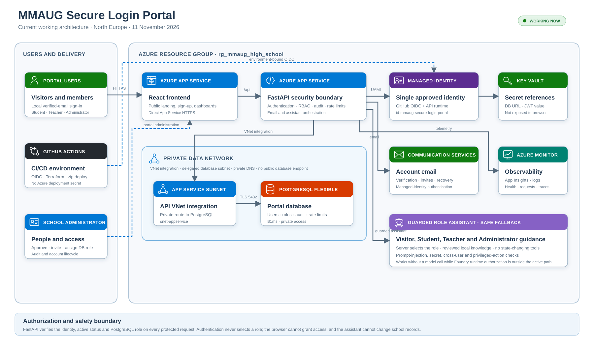

# MMAUG High School Secure Login Portal

Educational development MVP for RFP `MMAUG-AIDB-RFP-002`.

> **Educational-use caveat:** The MMAUG Secure Login Portal is a solution built as
> part of the Malta Microsoft AI User Group (MMUAG) AI & DevOps Fundamentals
> Bootcamp 2026. The solution is for demo/educational purposes and not to be adopted
> as a production-ready system.

## Architecture



- Public React + TypeScript landing page with Microsoft and email/password account paths
- FastAPI protected API with server-side role and account-status checks
- PostgreSQL application profiles and append-only audit events
- Microsoft Foundry Agent Service with `gpt-5.4-mini`, role-isolated File Search stores,
  managed identity, deterministic guardrails and a safe outage fallback
- Azure App Service Plan, private PostgreSQL, VNet/private DNS, Key Vault, Azure
  Communication Services, Application Insights, and one approved user-assigned identity
- Terraform infrastructure and GitHub Actions deployment through OIDC

The development portal is live at
[`app-mmaug-development-web-gkt6d.azurewebsites.net`](https://app-mmaug-development-web-gkt6d.azurewebsites.net).
Microsoft sign-in is pending the tenant administrator's SPA/API registrations and client
IDs; local verified-email accounts are active for synthetic demonstrations.

Microsoft accounts use the identity platform `common` authority; non-Microsoft visitors
can create a password account whose Argon2id hash is stored separately. Authentication
does not grant portal access: every new account is inactive until an administrator assigns
and activates its PostgreSQL role. Microsoft identities are keyed by immutable
`tenant ID + object ID`. See
[docs/architecture.md](docs/architecture.md).

The MVP contains synthetic data only. It is not approved for real student data.

The application role comes from PostgreSQL after token validation. The frontend never
selects the authorization role, and the assistant receives only the role chosen by the
API. Reviewed assistant source material is in [`knowledge-base`](knowledge-base).
The implementation and update procedure are documented in
[the Foundry assistant and knowledge-base guide](docs/ai-assistant-and-knowledge-base.md).

Self-registration never accepts a role. All new requests start as inactive Student
records; only the Administrator dashboard can activate an account or assign Teacher or
Administrator. The controlled first-admin procedure is documented in
[docs/first-administrator.md](docs/first-administrator.md).

Direct Azure App Service HTTPS is the active ingress. The solution uses managed identity
and GitHub OIDC instead of an Azure deployment client secret.

## Local development

Prerequisites: Python 3.11+, Node.js 20+, and Docker Desktop for PostgreSQL.

```powershell
Copy-Item .env.example .env
docker compose up -d postgres
python -m venv .venv
.\.venv\Scripts\python -m pip install -e ".\backend[dev]"
$env:PYTHONPATH = ".\backend"
.\.venv\Scripts\python -m app.seed
.\.venv\Scripts\python -m uvicorn app.main:app --reload --app-dir backend
```

In another terminal:

```powershell
Set-Location frontend
npm install
npm run dev
```

Local development authentication is disabled by default. Set `ALLOW_DEV_AUTH=true`
only on a developer workstation and use one of the eight seeded email addresses in
the `X-Dev-User` header. Production refuses this mode.

## Verification

```powershell
.\.venv\Scripts\python -m pytest backend/tests
Set-Location frontend
npm run lint
npm run build
```

See [docs/deployment.md](docs/deployment.md) for Azure and OIDC setup and
[docs/security.md](docs/security.md) for the security boundary.

The updated RFP response is available as
[proposal source](docs/proposal-v5.md) and
[Version 5 PDF](MMAUG_Secure_Login_Portal_RFP_Response_v5_Current_Architecture.pdf).
