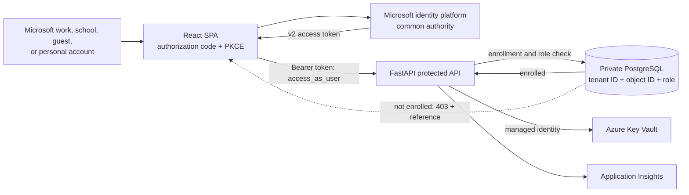
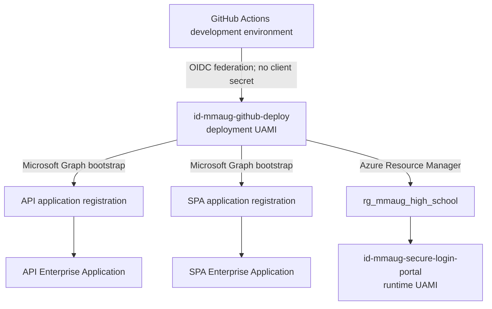

# Solution architecture

## Identity model

The portal accepts Microsoft work, school, guest, and personal accounts through the
Microsoft identity platform `common` authority. An arbitrary email/password provider is
not accepted directly; a non-Microsoft identity must first be invited as a guest or be
connected through Microsoft Entra External ID.

Authentication and authorization remain separate:

- Microsoft verifies the account and issues the access token.
- FastAPI validates the token signature, v2 issuer, audience, lifetime, tenant ID,
  object ID, and delegated `access_as_user` scope.
- PostgreSQL looks up the composite `(entra_tenant_id, entra_object_id)` identity.
- A valid but unenrolled account receives an enrollment reference and no portal data.
- PostgreSQL assigns the application-level student, teacher, or administrator role.
  Portal administrators are not Microsoft Entra tenant administrators.

## Directory and deployment objects

Creating an application registration creates an application definition. Creating its
service principal creates the corresponding Enterprise Application in the home tenant.
The deployment UAMI performs this bootstrap from GitHub OIDC. The runtime UAMI is never
used for directory administration.

After the final HTTPS redirect URI and consent are configured, remove broad Microsoft
Graph bootstrap permissions from the deployment identity unless repeatable directory
provisioning is an approved operational requirement.
