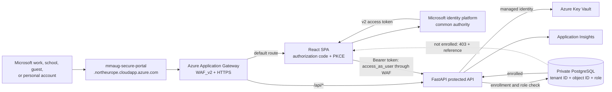
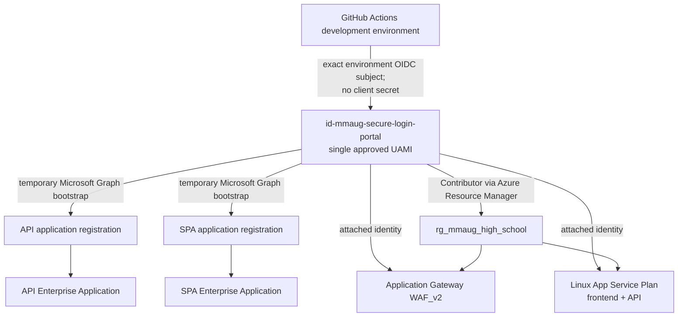

# Solution architecture

## Identity model

The portal accepts Microsoft work, school, guest, and personal accounts through the
Microsoft identity platform `common` authority. An arbitrary email/password provider is
not accepted directly; a non-Microsoft identity must first be invited as a guest or be
connected through Microsoft Entra External ID.

Authentication and authorization remain separate:

- Microsoft verifies the account and issues the access token.
- FastAPI validates the token signature, v2 issuer, audience, lifetime, tenant ID,
  object ID, and delegated `access_as_user` scope.
- PostgreSQL looks up the composite `(entra_tenant_id, entra_object_id)` identity.
- A valid but unenrolled account receives an enrollment reference and no portal data.
- PostgreSQL assigns the application-level student, teacher, or administrator role.
  Portal administrators are not Microsoft Entra tenant administrators.

## Directory and deployment objects

Creating an application registration creates an application definition. Creating its
service principal creates the corresponding Enterprise Application in the home tenant.
Per the approved design, the same UAMI performs GitHub deployment, temporary directory
bootstrap, Key Vault access, and workload identity. This is operationally simple but has
a larger blast radius than separate deployment and runtime identities.

The obsolete `id-mmaug-github-deploy` identity was permanently deleted on 9 November
2026 after confirming that it had no Azure role assignments. Only
`id-mmaug-secure-login-portal` remains in the resource group.

This GitHub organization customizes OIDC subjects with immutable owner and repository
IDs. The working trust is
`repo:Eniola-007@78024150/mmaug-secure-login-portal@1450348387:environment:development`.

After the final HTTPS redirect URI and consent are configured, remove broad Microsoft
Graph bootstrap permissions from the identity unless repeatable directory
provisioning is an approved operational requirement.

Application Gateway is the public HTTPS endpoint. The Azure-provided DNS label
`mmaug-secure-portal.northeurope.cloudapp.azure.com` was available when checked on
9 November 2026 and is now reserved by Standard static Public IP `68.219.97.185`. The gateway
redirects HTTP to HTTPS, applies
the OWASP 3.2 managed rules in Prevention mode, sends `/api/*` to FastAPI, and sends all
other paths to the React frontend.

No application client secret or GitHub deployment secret is used. HTTPS nevertheless
requires a CA-issued certificate with a private key. Application Gateway does not issue
that certificate; the approved design stores it in Key Vault and lets the managed
identity retrieve it. This certificate object is distinct from an Entra client secret.
