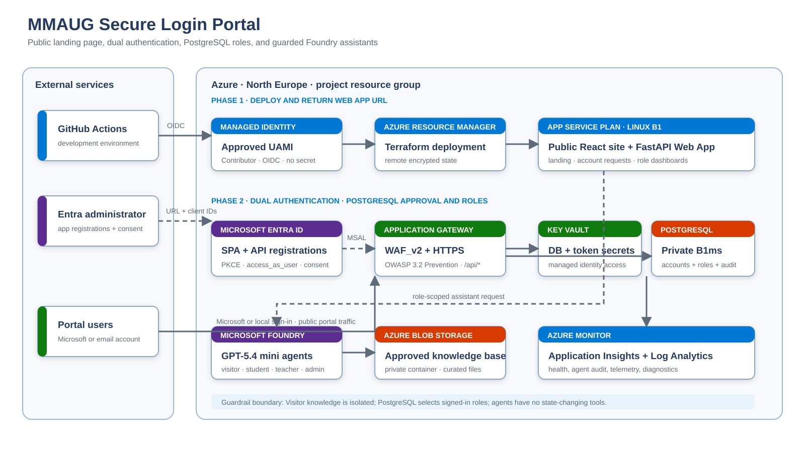

# Solution architecture

## Approved deployment sequence

The solution follows the administrator-approved infrastructure-first handoff. The
managed identity deploys Azure resources and application packages; it does **not** create
or administer Microsoft Entra app registrations.

1. GitHub Actions exchanges its environment-bound OIDC token for
   `id-mmaug-secure-login-portal` without a client secret.
2. The managed identity uses Contributor on `rg_mmaug_high_school` to deploy Terraform
   infrastructure, the FastAPI package, and the React package.
3. The first deployment uses zero-UUID placeholders and displays a safe “MSAL pending”
   message rather than initiating an invalid sign-in.
4. The workflow returns the direct frontend App Service HTTPS URL.
5. The Entra administrator creates the SPA and API registrations, exposes delegated
   `access_as_user`, adds the returned redirect URL, configures consent, and returns both
   client IDs.
6. The client IDs are saved as protected GitHub environment variables and the same OIDC
   workflow rebuilds the portal with MSAL enabled.
7. Application Gateway WAF_v2 and the reserved public hostname become the final ingress
   after the trusted TLS certificate is available.
8. The existing VNet remains in place for private PostgreSQL and the optional Application
   Gateway. It is not removed during the current deployment.

## Microsoft identity and application authorization

The final portal accepts Microsoft work, school, guest, and personal accounts through
the Microsoft identity platform `common` authority. The SPA uses authorization code with
PKCE; no SPA client secret is created.

- Microsoft Entra verifies the account and issues a v2 access token.
- FastAPI validates signature, issuer, signing-key issuer, audience, lifetime, tenant ID,
  object ID, and delegated `access_as_user` scope.
- PostgreSQL resolves the immutable `(entra_tenant_id, entra_object_id)` pair.
- Authenticated but unenrolled identities receive no portal data.
- PostgreSQL supplies the student, teacher, or administrator portal role.

## Role-aware assistant and knowledge boundary

The API selects the assistant from the PostgreSQL role after authentication; the browser
cannot select or assert a role. Student, teacher, and administrator dashboards each expose
their own guarded assistant experience.

- The approved model is the `gpt-5.4-mini` deployment in Microsoft Foundry.
- Curated Markdown guidance is published to the private `knowledge-base` container in an
  Azure Storage account and ingested into a Foundry file-search vector store.
- The App Service user-assigned managed identity is the preferred Foundry credential. The
  administrator-approved service principal is also supported when the three `AZURE_AD_*`
  GitHub Environment secrets are configured; its secret is written directly to Key Vault
  and App Service receives only a Key Vault reference.
- The identity selected for Foundry must receive **Foundry User** and the storage data role
  required by the selected Foundry setup.
- Server-side guardrails reject prompt-injection, secret, cross-user-data, and privileged
  action requests before a model call.
- Agents have no state-changing tools. Every request records only role, mode, and outcome;
  the question text is not copied into the audit event.
- When Foundry is not configured or unavailable, the portal returns a constrained local
  welcome message rather than bypassing the boundary.

## Deployment identity boundary

Only `id-mmaug-secure-login-portal` exists in the project resource group. Its verified
GitHub trust uses the immutable repository-ID subject:

`repo:Eniola-007@78024150/mmaug-secure-login-portal@1450348387:environment:development`

The identity is authorized for Azure Resource Manager deployment and approved workload
access. It is deliberately not assigned Microsoft Graph directory permissions. Entra
app-registration ownership and tenant-wide consent remain with the administrator.

## Network and data path

- Initial handoff URL: direct HTTPS frontend App Service hostname returned by Terraform.
- Final hostname: `mmaug-secure-portal.northeurope.cloudapp.azure.com`, reserved on
  Standard static Public IP `68.219.97.185`.
- Final ingress: Application Gateway WAF_v2, HTTP-to-HTTPS redirect, OWASP 3.2 Prevention.
- Routing: `/api/*` to FastAPI; all other paths to the React SPA.
- Database: PostgreSQL Flexible Server B1ms on a delegated subnet with no public access.
- AI knowledge: private Blob container containing only reviewed school-service guidance.
- AI runtime: managed-identity Foundry access with separate role agent names and
  `gpt-5.4-mini` as the approved deployment.
- Secrets: generated database bootstrap credential in encrypted Terraform state and Key
  Vault; no Entra client secret or App Service publishing credential.
- Monitoring: workspace-based Application Insights and Log Analytics.

Application Gateway activation is a second deployment stage because HTTPS requires a
trusted certificate with a private key. Key Vault stores that certificate and the managed
identity retrieves it; the certificate is not an Entra client secret.
