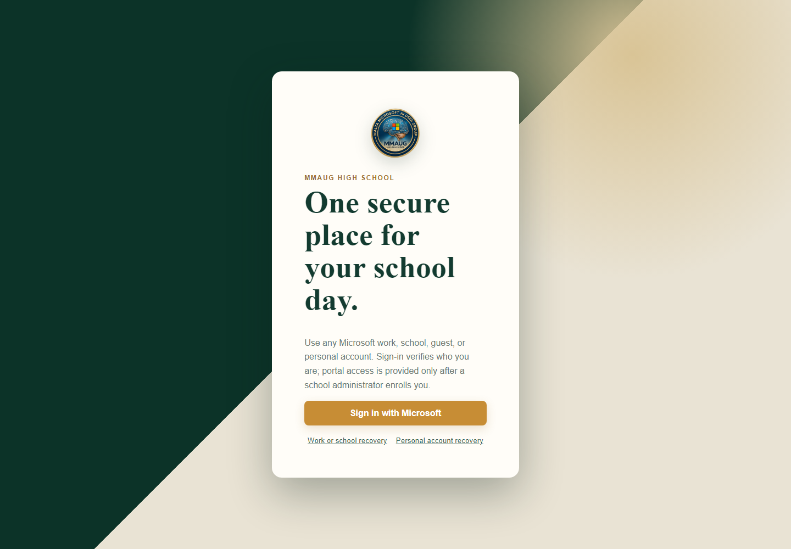

# Verification evidence — 9 November 2026

This report records the parts of the MMAUG Secure Login Portal verified before the Entra
administrator grants the temporary Microsoft Graph bootstrap permissions.

## Verified successfully

| Area | Evidence | Result |
|---|---|---|
| Portal UI | Vite development server and headless browser render | Pass |
| School branding | Supplied MMAUG logo displayed on the sign-in card | Pass |
| Backend authorization | `python -m pytest backend/tests -q` | 12 tests passed |
| Python quality | `python -m ruff check backend` | Pass |
| Frontend quality | `npm run lint` | Pass, zero warnings |
| Production frontend | `npm run build` | Pass |
| Infrastructure syntax | `terraform fmt -check` and `terraform validate` | Pass |
| Managed identity count | Azure resource-group query | One approved UAMI |
| Azure authorization | Role-assignment query | Contributor at project resource group |
| GitHub federation | GitHub Actions `azure/login` using repository-ID subject | Pass |
| Public endpoint reservation | Azure Standard static Public IP | Provisioned |
| DNS resolution | Azure regional hostname A record | Pass |

## Portal render

## Live Azure evidence

- The resource group contains exactly one approved user-assigned managed identity.
- The identity has Contributor at the project resource-group scope.
- The approved regional DNS name resolves to the reserved Standard static Public IP.
- GitHub Actions successfully exchanged its environment-bound OIDC assertion for an
  Azure token using the approved identity.

The workflow proves GitHub-to-Azure OIDC login. Its next step is presently denied by
Microsoft Graph because the identity has not yet received the administrator-approved
`Application.ReadWrite.All` and `DelegatedPermissionGrant.ReadWrite.All` bootstrap roles.

## Pending administrator-dependent verification

- Creation of the SPA and API registrations and Enterprise Applications.
- Tenant-wide delegated consent for `access_as_user`.
- Real Microsoft sign-in through the final HTTPS endpoint.
- Full Terraform deployment of App Service, PostgreSQL, Application Gateway, WAF, and TLS.
- Enrollment and role-isolation demonstration with eight real Entra object IDs.

These pending items cannot be represented as passed until an Entra administrator grants
the temporary Graph roles and the live deployment and acceptance tests complete.
