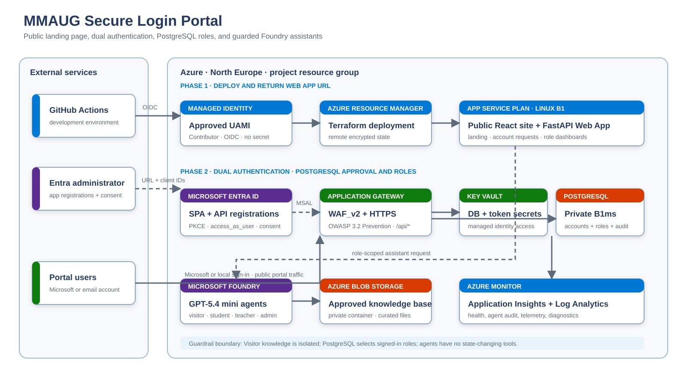

# MMAUG Secure Login Portal — Updated Technical Proposal

**Response:** MMAUG-AIDB-RFP-002  
**Version:** 4.1 — Infrastructure-first deployment and Entra administrator handoff
**Date:** 9 November 2026

## Executive proposal

The proposed solution delivers a secure school portal for students, teachers, and
administrators using a React frontend, FastAPI protected API, and private PostgreSQL.
Microsoft Entra authenticates users after the tenant administrator creates and approves
the application registrations. The portal database independently determines whether an
authenticated identity is enrolled, active, and authorized for a portal role.

The delivery model follows the administrator's approved sequence: GitHub Actions uses
OIDC to the single Contributor managed identity, deploys the Azure infrastructure and
application code, and returns the direct frontend Web App URL. The administrator then
creates the SPA/API registrations and configures scopes, consent, and redirect URIs.
A second deployment injects only the resulting non-secret client IDs and enables MSAL.

## Approved Azure architecture

| Area | Approved design |
|---|---|
| Azure scope | Project tenant and resource group in North Europe |
| Managed identity | One UAMI with Contributor at project resource-group scope |
| CI/CD authentication | Exact GitHub environment OIDC subject; no client secret |
| Deployment state | Private Azure Storage blob state, encrypted at rest |
| Initial public URL | Direct HTTPS frontend App Service URL returned after deployment |
| Final public entry point | Application Gateway WAF_v2 with HTTP-to-HTTPS redirect |
| Final DNS | Reserved regional Azure hostname on a Standard static Public IP |
| Application hosting | One Linux B1 App Service Plan with separate frontend and API apps |
| Database | Private PostgreSQL Flexible Server B1ms for development |
| Secrets and certificates | Key Vault references; no secret is committed to source |
| Monitoring | Workspace-based Application Insights and Log Analytics |

## Separation of duties

The managed identity performs Azure Resource Manager deployment only. It is not granted
Microsoft Graph directory permissions and does not create Enterprise Applications or
tenant-wide consent grants.

The Entra administrator owns these directory operations:

- create the SPA application registration and its Enterprise Application;
- create the API application registration and its Enterprise Application;
- expose `api://<API_CLIENT_ID>/access_as_user` as a delegated scope;
- add that delegated permission to the SPA and grant the approved consent;
- configure `http://localhost:5173` and the returned frontend HTTPS URL as SPA redirects;
- provide the SPA and API client IDs for protected GitHub environment variables; and
- confirm whether Microsoft personal accounts are permitted by tenant policy.

No client secret is created for the SPA, API, GitHub workflow, or managed identity.

## Two-stage deployment

### Stage 1 — infrastructure and application handoff

GitHub exchanges its OIDC assertion for the approved managed identity. Terraform creates
the VNet, private PostgreSQL, Key Vault, monitoring, B1 App Service Plan, frontend Web App,
and API Web App. Terraform state is held in a private Storage container. A generated
database bootstrap password is retained only in encrypted state and Key Vault.

The React package is deliberately built with zero-UUID placeholders. The page displays a
clear “Microsoft sign-in is pending administrator app registration” notice and cannot
initiate a broken or insecure authentication flow. The workflow health-checks both apps
and reports the frontend and API HTTPS URLs.

### Stage 2 — MSAL activation

After the administrator returns the client IDs, deployment variables are updated and the
same workflow rebuilds and redeploys the application. The SPA then uses authorization
code with PKCE and requests `access_as_user`. FastAPI validates the resulting v2 access
token before consulting the portal enrollment and role tables.

### Stage 3 — WAF and final hostname

After a trusted TLS certificate is available, Application Gateway WAF_v2 becomes the
public entry point. It applies OWASP 3.2 managed rules in Prevention mode, routes
`/api/*` to FastAPI, routes other paths to React, and maintains HTTPS to both backends.

## Authorization and data protection

Successful Microsoft authentication does not automatically grant portal access. FastAPI
resolves the immutable `(tenant ID, object ID)` pair against PostgreSQL. Unenrolled or
inactive identities receive no portal data. Student, teacher, and administrator roles are
enforced by server-side dependencies and object-level checks.

PostgreSQL has no public endpoint. Secrets are referenced from Key Vault using managed
identity, and deployment uses OIDC instead of stored Azure credentials. Monitoring data
is sent to Application Insights and Log Analytics without granting portal users Azure
resource access.

## Acceptance plan

1. GitHub OIDC logs into Azure using the approved managed identity.
2. Terraform deploys the initial infrastructure and both Web App packages.
3. Health checks pass and the frontend URL is provided to the Entra administrator.
4. The administrator completes SPA/API registrations, scope, consent, and redirects.
5. The client IDs are configured and MSAL is enabled by a second deployment.
6. Eight synthetic demonstration identities are enrolled using their tenant/object IDs.
7. Tests verify sign-in, deny-by-default enrollment, role isolation, audit events,
   recovery, monitoring, WAF behavior, and absence of credentials from source control.

Real student data remains prohibited until privacy assessment, retention, backup and
restore, penetration testing, Conditional Access, incident response, and operational
ownership are separately approved.
