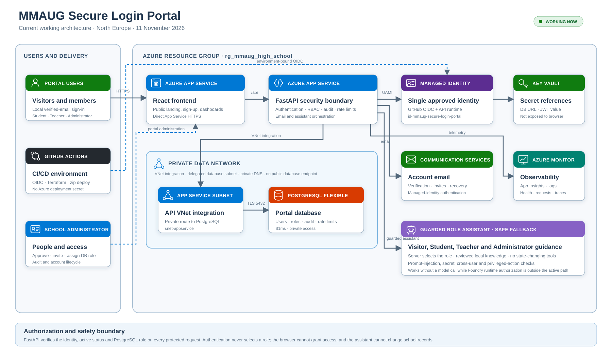

# MMAUG Secure Login Portal — Technical Proposal and Deployment Record

**Response:** MMAUG-AIDB-RFP-002  
**Version:** 5.1 — Current working implementation  
**Date:** 11 November 2026

> **Educational-use caveat:** The MMAUG Secure Login Portal is a solution built as part
> of the Malta Microsoft AI User Group (MMUAG) AI & DevOps Fundamentals Bootcamp 2026.
> The solution is for demo/educational purposes and not to be adopted as a
> production-ready system.

## Executive proposal

The solution provides a public school-service landing page and protected Student,
Teacher and Administrator workspaces. React supplies the frontend, FastAPI enforces the
security boundary, and private PostgreSQL stores user status, identity mappings, roles,
audit events, rate limits and local credentials.

The development environment is live at
`https://app-mmaug-development-web-gkt6d.azurewebsites.net`. Local email accounts,
verification, recovery, invitations, administrator approval, user deletion, per-user
activity and role dashboards are deployed. Microsoft sign-in remains disabled until the
tenant administrator supplies the SPA/API registration client IDs.

GitHub Actions deploys through OIDC to the single approved managed identity. The same
identity is attached to the API for approved Azure service access. No Azure deployment
secret or App Service publishing credential is stored in GitHub.

## Current Azure architecture

| Area | Deployed state |
|---|---|
| Azure scope | Tenant `71beefd7-29f4-4b9e-9cb2-e78b5dc851ad`, North Europe, `rg_mmaug_high_school` |
| Public URL | Direct frontend App Service HTTPS URL |
| Hosting | Linux B1 App Service Plan; separate React and FastAPI Web Apps |
| Deployment identity | `id-mmaug-secure-login-portal`; GitHub environment OIDC; Contributor at resource-group scope |
| Database | PostgreSQL Flexible Server 16, B1ms, VNet injected, private DNS, public access disabled |
| Secrets | Key Vault references for database and local-token values |
| Local identity | Argon2id password hashes, verified email, short-lived versioned JWTs |
| Email | Azure Communication Services using managed identity and Azure-managed sender |
| Monitoring | Workspace-based Application Insights and Log Analytics |
| AI platform | Foundry project and `gpt-5.4-mini` deployment provisioned |
| AI knowledge | Reviewed Markdown published to private Blob storage by the workflow |
| Current AI behavior | Deterministic guardrails plus constrained safe fallback until runtime Foundry RBAC is effective |

## Identity, enrollment and roles

Authentication and authorization remain separate. A valid local or future Microsoft
identity does not grant portal access. FastAPI reads the database record for every
protected request and rejects inactive or unauthorized users.

- New self-service accounts start inactive as Student and cannot request another role.
- Local users verify mailbox ownership before activation or role change.
- Administrators invite or re-invite people, select a database role, activate or
  deactivate access, delete other users and review audit activity.
- Students and teachers can view only activity performed by or targeting their own
  account.
- An administrator cannot delete or deactivate their own active portal account.
- Microsoft identities will be keyed by immutable tenant ID and object ID after MSAL is
  activated.

The browser never selects or asserts a role. PostgreSQL is the authorization source of
truth, and direct SQL role changes are excluded from normal operation because they bypass
verification and audit controls.

## Account communications

Azure Communication Services sends role invitations, mailbox verification, password
setup, recovery and administrator verification alerts. The API authenticates with the
managed identity and waits for the final ACS operation result before returning a success
message. Re-sending rotates unused setup or verification links.

This remains a demonstration email configuration. A verified school-owned sending domain,
delivery/suppression monitoring and operating procedures are prerequisites for broader
use.

## Assistant design and guardrails

The landing page exposes a Visitor assistant, and signed-in users receive Student,
Teacher or Administrator guidance selected by FastAPI from the PostgreSQL role. The
client cannot choose an agent identity.

Reviewed guidance is separated by audience. Before any model call, deterministic controls
reject prompt injection, secrets, cross-user data and role-changing actions. Assistants
have no database connection or state-changing tools, and question text is not written to
audit details.

The Foundry project and model deployment are provisioned. Current role-assignment evidence
does not show **Foundry User** for the API managed identity, so runtime calls safely fall
back to constrained local guidance. Completion requires the tenant's Owner or User Access
Administrator to grant that role and a subsequent grounded-answer and role-isolation test.

## Delivery model and separation of duties

The `development` GitHub environment federates to the approved managed identity. The
workflow validates Terraform, publishes reviewed knowledge, packages both applications,
deploys them and verifies live health. CI separately runs backend tests, coverage, lint,
frontend build and security checks.

The tenant administrator retains ownership of:

- the SPA and API app registrations and Enterprise Applications;
- delegated `access_as_user` scope and consent;
- local and deployed SPA redirect URIs;
- confirmation of supported Microsoft account types; and
- Azure RBAC assignments that Contributor cannot grant.

The SPA and API registrations require client IDs, not client secrets. Client IDs belong
in protected GitHub environment variables. The managed identity is deliberately not
given Microsoft Graph directory permissions.

## Network and data protection

PostgreSQL has no public endpoint. The API reaches it through App Service VNet integration,
the delegated database subnet and linked private DNS. Authorized database inspection uses
the API App Service SSH console or another approved client with private-network routing.

Database and JWT values are generated or stored in Key Vault and referenced by the API.
Passwords are Argon2id hashes; one-time values are stored as SHA-256 digests. Persistent
rate limits protect registration, sign-in, resend, verification and recovery endpoints.

Application Insights and Log Analytics collect service health, requests, dependencies and
exceptions. Portal audit records cover application actions; Azure telemetry is not used as
the portal authorization source.

## Current public ingress

The working public entry point is the frontend Azure App Service HTTPS URL. The current
architecture and acceptance record describe that deployed path only.

## Acceptance record

### Verified

1. GitHub OIDC authenticates as the approved single managed identity.
2. Terraform and application deployment complete through the protected workflow.
3. Frontend and PostgreSQL-backed API health return HTTP 200.
4. Local registration, verification, recovery, invitations and database role approval are
   implemented with rate limiting and audit events.
5. Student, Teacher and Administrator dashboards and role-aware guardrails are deployed.
6. PostgreSQL is private and the API uses VNet integration.
7. ACS accepts managed-identity email operations; the application now tracks their final
   operation result.
8. Foundry project and `gpt-5.4-mini` model deployment are provisioned.
9. Deployment run `43043200125` completed successfully for commit `1a2d442`.

### Remaining gates

1. Tenant administrator completes the SPA/API registrations and supplies both client IDs.
2. An Owner or User Access Administrator grants effective **Foundry User** to the runtime
   managed identity and grounded agents pass role-isolation testing.
3. Load, accessibility, backup/restore, privacy, retention, penetration, Conditional
   Access, incident-response and operational-ownership reviews are completed.

Real student data remains prohibited until those governance and assurance gates are
formally approved.

